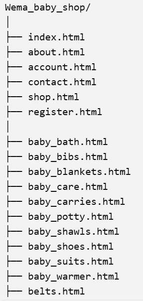
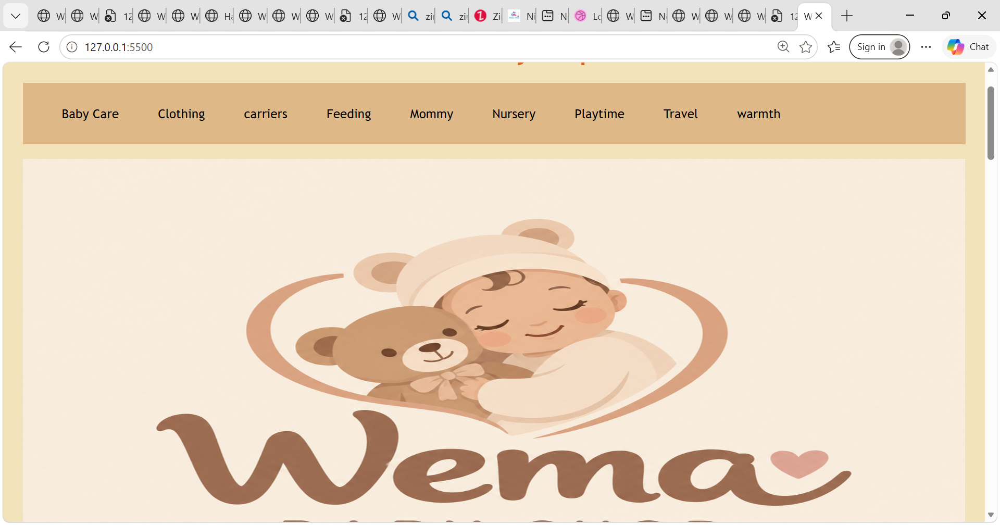
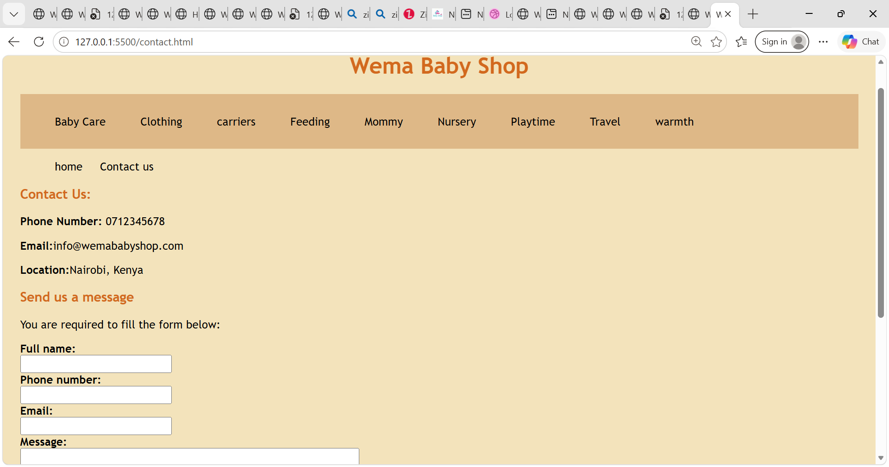
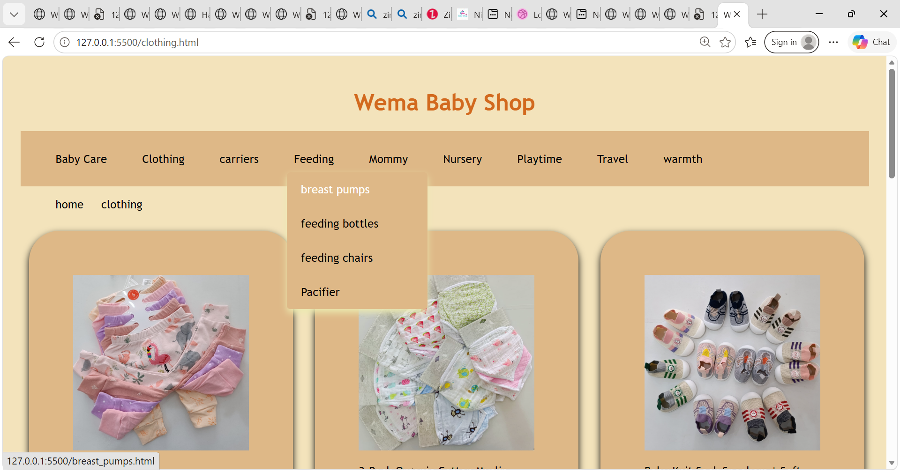
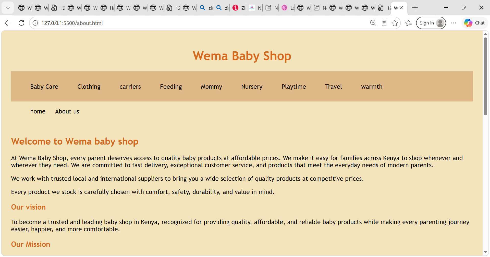

# Wema Baby Shop

This is a website for Wema baby shop located in Nairobi, Kenya.
 
 We make it easy for families across Kenya to shop whenever and wherever they need. We are committed to fast delivery, exceptional customer service, and products that meet the everyday needs of modern parents.

**live link**: https://mercymumbe.github.io/Wema_baby_shop/

## Project Description

Wema baby shop is a simple e-commerce website that allows customers to view different products, their and prices 

The website includes products such as baby cares, carriers, clothing, kids furniture, mommy nursing requirements, playtoys play mats and any other relevant product. 

## Problem Statement

Parents and caregivers often struggle to find reliable baby products, compare prices, check suitable sizes and ages, and know whether essential items are available before visiting a physical shop. Shopping for baby products can also be time-consuming, especially for busy parents who need convenient access to essential items.

## Business Role

The main goal of this website is to create an online presence for Wema baby shop where customers can view our products and choose the  products they need.

## Target Audience

The target audience includes parents, expectant mothers, caregivers, guardians, and anyone looking to buy baby products in Kenya.

The website helps them save time by allowing them to explore different product categories, compare prices, and find essential baby items in one place.

## Features

1. Home page

This page gives a brief on category of our products and featured products and includes a Shop Now button that takes users to the products section.

2. Products page

This section displays different products. Customers can also view more  products and their prices and Add to Cart buttons.

3. About Us page

This section gives information about Wema baby shop and explains our vision, our mission, what we offer, reasons for choosing us and our working team.

4.Contact page

This page provides the business phone number, email address and location in Nairobi, Kenya. it also has a form to fill customers details and write a message.

5. Account page
This page provides a section for our customer to sign in to our website.

6. Baby care page
This is a category page of products like bathing items, baby potty,washcloth acessories and teethers. 

7. Bathing basins and seat page
In this page customers can view different products and their prices.

8. Baby potty page
This page comprises of different Baby potty products and their prices.

9. Towel and washcloths page
This page comprises of different Baby towels products and their prices.

10. Teethers page
This page comprises of different Baby teethers products and their prices.

11. Clothing page
 This is a page of category products that includes; baby suits, baby bibs, baby shoes, custom design, dresses, kofia set, receiving set anad rompers.

 12. Baby suits page
 This page comprises of different Baby suits products and their prices.

 13. Baby bibs page
 This page comprises of different Baby bibs products and their prices.

 14. Custom Design page
 This page comprises of different custom design products and their prices.

 15. Dresses page
 This page comprises of different dress products and their prices.

  16. Kofia set page
This page comprises of different kofia set products and their prices.

18. Receiving set page
This page comprises of different receiving set products and their prices.

19. Rompers page
This page comprises of different Baby romper products and their prices.

20. Carriers page
This is a page of category of products that include; baby carriers and diaper bags.

21. Baby carriers
This page comprises of different Baby carrier products and their prices.

22. Diaper bags
This page comprises of different diaper bags products and their prices.

23. Feeding page
This is a page of category of products that includes; breast pumps, feeding bottles, feeding chair and pacifiers.

24. Breast pumps
This page comprises of different breast pumps products and their prices.

25. Feeding Bottles
This page comprises of different feeding bottles products and their prices.

26. Feeding Chairs
This page comprises of different feeding chair products and their prices.

27. Pacifier page
This page comprises of different pacifier products and their prices.

28. Mommy page
This page has a categories of mommy products.
These include; belts and nursing bras.

29. Belts page
This page comprises of different belt products and their prices

30. Nursing bras page
This page comprises of different nursing bras products and their prices

31. Nursery page
This page provides a category of Nursery products.
These include; Kids furniture, nests and bassinets and pillaws.

32. Kinds and furniture page
This page comprises of different Baby bed products and their prices.

33. Nests and bassinets page
This page comprises of different nets and bassinets products and their prices.

34. Pillows page 
This page comprises of different nursing pillow products and their prices.

35. Playtime page
This page provides a category of playtime products.
These products include; playmats and toys.

36. Playmats page
This page comprises of different playmat products and their prices.

37. Toy page
This page comprises of different toy products and their prices.

38. Travel page
This page provides a category of essential  travel baby products
These products include; child safety car seat and swings & rockers.

39. Child safety car seat
This page comprises of different child and safety car seat products and their prices.

40. Swings and rockers page
This page comprises of different swings and rockers products and their prices.

41. Warmth page
This page provides a category of baby warm fundamentals.
These include; baby blankets, baby warmers and baby shawls.

42. Baby Blankets page
This page comprises of different baby blanket products and their prices.

43. Baby warmers page
This page comprises of different baby warmer products and their prices.

44. Baby shawls page
This page comprises of different baby shawl products and their prices.

45. dashboard page
This is a staff dashboard.
This page provides details of orders, pending orders, delivered and in progress

## Style Guide

Wema Baby Shop website uses a simple, clean, and user-friendly design to make online shopping easy for customers.

Colours: Soft and attractive colours that create a warm, welcoming, and baby-friendly appearance.

Typography: Clear and readable fonts to make product names, prices, and other information easy to understand.

Images: Clear product images that help customers identify the items they want to buy.

Layout: Products are arranged in categories and product cards to make browsing easier.

Buttons: Clearly visible buttons such as Shop Now and Add to Cart help customers navigate and interact with the website.

Navigation: Simple navigation links help users move between the Home, Products, About Us, Contact, and Account pages.

## Responsive Design: How the Site Adapts to Screen Sizes

The website is designed to provide a user-friendly experience across different screen sizes, including desktops, laptops, tablets, and mobile phones.

Desktop: Products are displayed in multiple columns, allowing customers to view several items at once.

Tablet: The layout adjusts to fit the smaller screen, with product cards arranged in fewer columns.

Mobile phone: The layout can use fewer columns, smaller images, and appropriately sized buttons to make browsing easier on smaller screens.

Navigation: Navigation elements should adjust to fit smaller screens and remain easy to use.

Images and content: Images and page content should resize to fit the available screen width and reduce unnecessary horizontal scrolling.

CSS media queries, flexible layouts, and responsive image sizing can be used to achieve these adjustments.

## Challenges

During the development of the Wema Baby Shop website, i experienced the following challenges;

Organising products: Arranging many baby products into suitable categories and individual pages required careful planning.

Page navigation: Creating links between the main pages, product categories, and individual product pages required attention to ensure users could navigate easily.

Product presentation: Displaying product images, names, and prices clearly while maintaining a consistent layout was important.

Responsive design: Making the website easy to use on different screen sizes required careful CSS styling and layout adjustments.

Time management: Developing multiple pages while maintaining a consistent design required time and planning.

Website functionality: Ensuring that buttons, forms, and navigation links work as expected was an important part of testing the website.

## Technologies Used

HTML5
CSS3
Git and GitHub for version control
Visual Studio Code
AI

## Project Structure

## Setup Instructions

### Run it on your computer
Clone the repository.

https://github.com/mercymumbe/Wema_baby_shop.git

Go into the project folder.

Search for  Wema Baby shop

Open index.html in your browser (Chrome, Firefox or Safari).

You can also right-click index.html in VS Code and choose Open with Live Server.

## Deploy to GitHub Pages

Push the project to a GitHub repository.
In the repository, go to Settings → Pages.
Under Branch, choose main and the / (root) folder.
Click Save.
Wait a few minutes for the website to be published.

## Screenshots

## Author

Mercy Mutua, Zindua School.

